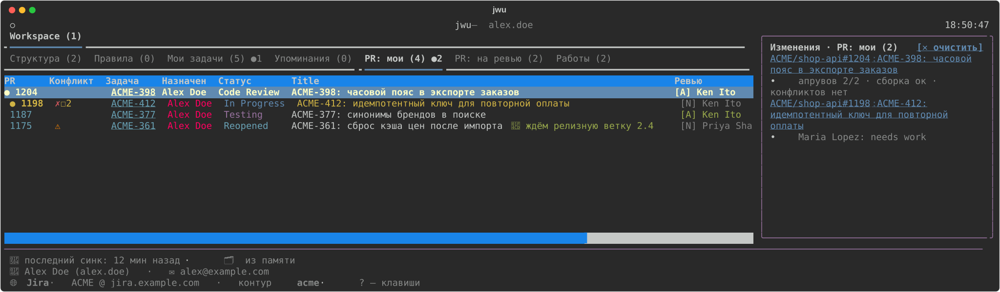
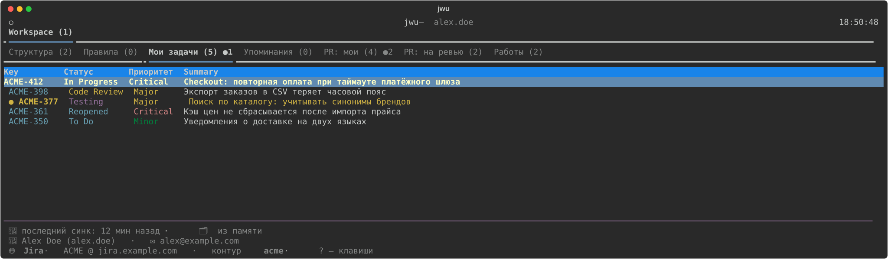

# jwu

Помощник по задачам для разработчика, работающего с **Jira / Bitbucket / Jenkins** или **GitHub**:
CLI, TUI-дашборд и MCP-сервер со скиллами для **Claude Code**, **Cursor** и **Codex**. Держит под
рукой задачи, PR, заметки и журнал работы, следит за ними в фоне и пишет в Telegram, когда нужно
твоё внимание. Решения остаются за тобой: наружу без твоего «да» ничего не уходит.



## Что умеет

**Задачи и PR**
- Мои задачи, упоминания, мои PR и PR на ревью — с конфликтами, сборками и задачами на комментах.
- Разбор красной сборки (Jenkins / GitHub Actions): наш баг или регресс из целевой ветки.
- Вложения задачи для анализа: скриншоты, логи, архивы и запись экрана — нарезанная на кадры
  через заданный шаг с контактным листом.
- Запись в Jira и PR только после подтверждения: комменты, статусы, ворклоги, создание PR,
  ответы ревьюерам, коммент точно на строку диффа. Правка и удаление — только своего.
- Трекинг времени цепочкой: «с 10:00 по МСК», ворклоги подряд без дыр.

**Фон и уведомления**
- Демон синкает все контуры по расписанию и сообщает в Telegram: конфликт, красная сборка,
  needs work, вернули с тестов, коммент QA, упоминания, «PR готов к мержу».
- «Моё» и «участвую» — отдельными сообщениями; у задачи — исполнитель, статус и приоритет,
  события — цитатой «что ……… кто», у смены статуса — кто перевёл.
- Бот двусторонний: `/sync`, `/status`, «что сделал сегодня», ответ на уведомление — заметка; Matrix в Telegram: `/duty` — дежурство за комнатой, `/personal` — непрочитанное 1:1 и упоминания.

**Память**
- Воркспейсы: рабочий и личный контуры не пересекаются, выбираются по папке.
- Работы (журнал цикла правок) с handoff для следующей сессии, заметки по задаче/PR/ветке,
  правила проекта, которые агент обязан соблюдать.
- Синк памяти между машинами через свой приватный git, бэкап и восстановление.

**Для агента (Claude Code, Cursor, Codex)**

jwu работает как помощник по задачам: собирает контекст, ведёт работу по шагам и спрашивает
тебя перед каждым заметным действием.

- **Скиллы на каждый день.** Показать, что сейчас важно сделать; начать задачу или продолжить
  начатую; проверить свой код, чужой PR или всю очередь ревью; разобрать возврат с тестов;
  помочь на дежурстве; написать сообщение в 4test или коммит; прибрать за сессиями.
- **[Работа над задачей](docs/workflow.md).** Агент предлагает план, а после твоего «да» правит
  код, гоняет тесты и сам проверяет результат. В конце готовит тексты для PR и задачи и
  спрашивает, что из этого опубликовать.
- **[Git под присмотром](docs/git.md).** Коммиты, пуши и обновление веток идут через jwu и по
  правилам, которые задаёшь ты. Что-то агент делает сам, что-то только после «да», что-то только
  после подтверждения кнопкой в боте, а что-то не делает никогда. Перед рискованными шагами jwu
  сохраняет копию, чтобы можно было откатиться.
- **Тексты твоим голосом.** Суть ответа готовит тот, кто разбирался в вопросе. Потом jwu
  подстраивает текст под твою манеру: длину, тон, привычные обороты.
- **Confluence.** Читать, создавать и править страницы.
- **Zephyr Scale.** Тест-кейсы по задаче — черновик пишет агент, сохраняются после твоего «да».
- **Стенды по SSH.** Смотреть логи стенда, только чтение.



## Установка

Нужны Python 3.10+ и [pipx](https://pipx.pypa.io).

```bash
pipx install git+<адрес этого репозитория>   # или из клона: pipx install .
jwu install                                  # скиллы + MCP для Claude Code (--for cursor | codex | both | all)
jwu init ~/code/my-project --provider jira    # подключить проект (jira | github | local)
```

Дальше `jwu configure` — хосты и токены, `jwu doctor` — проверить, что всё на месте,
`jwu dashboard` — открыть дашборд. В сессии агента начни с `/jwu-session-init`.

## Документация

- [Работа над задачей](docs/workflow.md) — какую рутину jwu берёт на себя, где спрашивает, что только после «да»
- [Установка и настройка](docs/setup.md) — Cursor и Codex, обновление, воркспейсы, доступы, бэкап
- [Синк, демон и Telegram](docs/notifications.md)
- [Задачи, PR и память](docs/tasks-and-prs.md) — запись наружу, трекинг времени
- [Скиллы, субагенты и MCP](docs/agents.md) — в том числе агент голоса
- [Политика git](docs/git.md) — что агенту можно делать с git, допуски, хук, уборка копий
- [Confluence, Zephyr, пуш работы, SSH-стенды](docs/integrations.md)
- [Аддоны](docs/addons.md) — свои команды, инструменты, кнопки бота; вкл/выкл, зависимости
- [Дашборд](docs/dashboard.md) · [Все команды](docs/commands.md)
